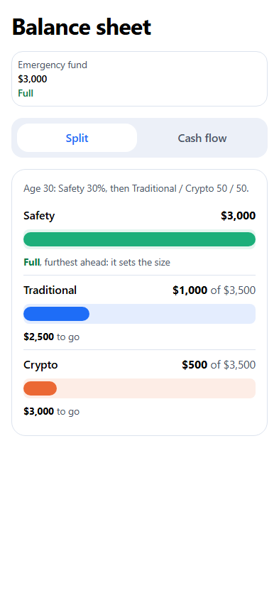
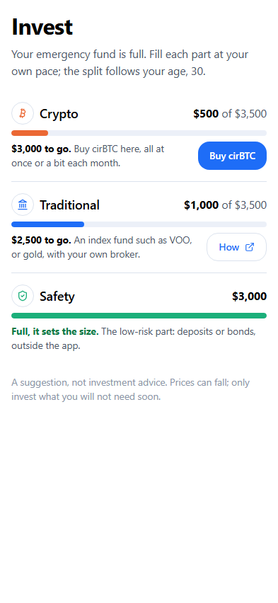
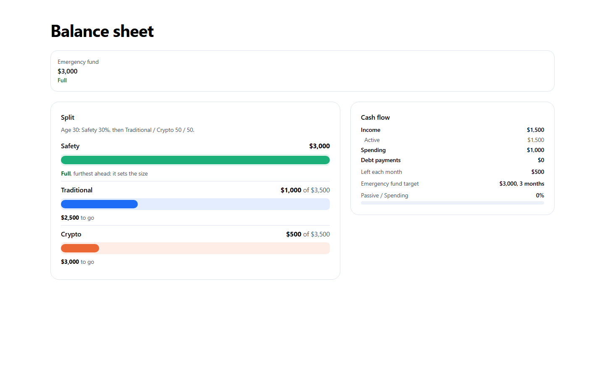

# MoonSafe

**Your personal finance agent for Web3.** MoonSafe keeps your emergency fund safe in your own USDC vault on Arc, then advises how to balance the rest of your money by age. You decide and do; it records and keeps track.

Test version live on Arc mainnet: **https://test.moonsafe.app** (moonsafe.app redirects there for now)

<p align="center">
  
  &nbsp;&nbsp;
  
</p>

## The problem

Most Web3 users hold nearly everything in volatile assets and keep no cash buffer. One bad month (a lost job, a medical bill, a crash) forces them to sell at the bottom. Saying "I have an emergency fund" is easy; actually keeping one is not.

## How it works

1. **The emergency fund comes first, onchain.** It lives in your own vault contract on Arc, so the agent can check it is really there. Nobody can claim a fund they do not have and then go all in. The target is 3 to 12 months of spending, depending on how steady your income is and who relies on you. Until it is full, the agent gives no investing advice.
2. **Then three parts, balanced by age.** Safety (the low-risk part: term deposits, bonds) is your age in %. The rest is split between Traditional (index funds such as VOO, gold) and Crypto (mostly BTC), 50/50 by default or any split you choose.
3. **The part furthest ahead sets the size.** Its bar is full; the others follow it. At 30 with $3,000 of Safety, Traditional and Crypto are each full at $3,500. You top them up from income or spare money, in any order. Nothing is ever "over", so the agent never tells you to sell.
4. **You decide, the agent keeps track.** Every change to what you hold is shown on a card you confirm. Spare money (cash, bank, stablecoins you have not set aside) is not tracked; bank money or stablecoins become Safety only when you say so.

Not invested yet? The agent gives the three shares (for example, of every $100: $30 Safety, $35 Traditional, $35 Crypto) and you top up little by little.

<p align="center">
  
</p>

## What is onchain

- **Emergency fund:** one minimal-proxy vault per user, plain USDC. Only your wallet can withdraw.
- **Crypto:** buy cirBTC in the app through Circle App Kit. Tokenized stocks and gold on Arc will join the same Invest list as they arrive.

You sign every transaction yourself. The AI never holds keys and never moves money.

## Why Arc

USDC is the native gas token, so the vault holds plain USDC and users never need another token. Fees are small and predictable, finality is sub-second, and cirBTC is native on Arc.

## Contracts (Arc mainnet, chain 5042)

| Contract | Address |
|---|---|
| VaultFactory | [`0xA9A5447a1Dd9874c25238d69E285249Fa1c9E10A`](https://explorer.arc.io/address/0xA9A5447a1Dd9874c25238d69E285249Fa1c9E10A) |
| VaultProxy (implementation) | [`0xd139b06b1bb5303a4fbA25E2B2297Cf1515cAACE`](https://explorer.arc.io/address/0xd139b06b1bb5303a4fbA25E2B2297Cf1515cAACE) |
| Owner: Safe 2-of-2 | [`0xC4c428c635913e5937BA0DA6E060E495f5a664b9`](https://explorer.arc.io/address/0xC4c428c635913e5937BA0DA6E060E495f5a664b9) |

Both are verified on Sourcify (exact match). Vaults are not upgradeable and have one permanent owner. Opening a vault costs 1 USDC; the factory owner can change the fee or pause new vaults, never touch vault funds.

## Security roadmap

Next vault version (after the hackathon): withdrawing needs **two separate keys, your wallet and your email**, like a 2-of-2 multisig, so a stolen wallet alone cannot empty the fund. A wallet-only withdrawal stays possible after a 7-day wait that your email can cancel, so funds never depend on MoonSafe's server. See [`docs/CORE.md`](docs/CORE.md) §6.

## Tech stack

- **Contracts:** Solidity, Foundry, OpenZeppelin. 322 tests, including fuzz and invariant tests.
- **App:** React, Vite, Tailwind, wagmi and viem, Privy (email, Google or wallet login).
- **Swap:** Circle App Kit (USDC to cirBTC).
- **Backend:** Cloudflare Pages Functions, KV and D1. The advisor runs on OpenAI gpt-5.4-mini with Claude Haiku as fallback; every figure in a plan is computed in code, not by the model.

## Run it

```bash
bun install
bun run dev          # app (testnet by default)
forge test           # contracts
npm run check:all    # framework, flows and language checks
```

Production build: `VITE_NETWORK=mainnet VITE_FACTORY_ADDRESS=<factory> bun run cf:deploy`.

## Repo map

- `docs/CORE.md`: the rules the app is built on (start here)
- `contracts/`: VaultFactory, VaultProxy, tests, deploy script
- `src/`: the app; `src/kb/`: the finance framework as data; `src/lib/allocation.ts`: the balance maths
- `functions/`: API for chat, user data, prices, admin
- `scripts/`: checks, agent evaluations, mainnet preflight
- `docs/archive/`: older specs and audits
